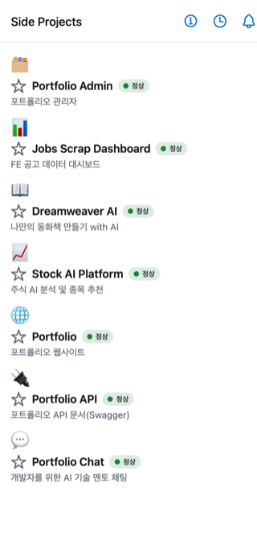
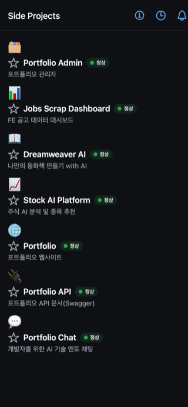
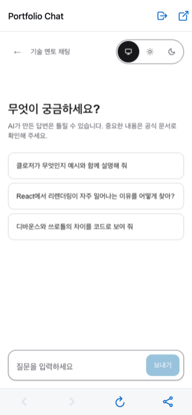
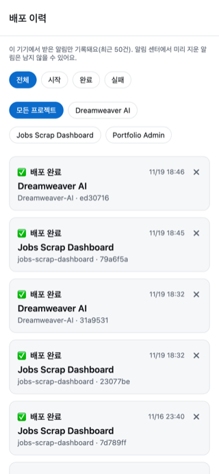

```json
{
  "schemaVersion": 1,
  "slug": "side-projects-app",
  "title": "사이드 프로젝트를 한 앱에서 열고 배포 알림까지 받는 허브 앱",
  "description": "흩어진 사이드 프로젝트를 한 앱의 목록으로 모으고 WebView로 실제 서비스를 이용하게 한 React Native + Expo 앱입니다. 앱을 다시 빌드하지 않고 바뀌는 원격 카탈로그, 허용 목록 기반 URL 정책, 배포 푸시 알림과 이력, 생체 인증 앱 잠금, OTA 업데이트를 갖췄습니다.",
  "image": "https://raw.githubusercontent.com/side-projects-labs/side-projects-app/687689f6835902e7d083f99142d72b5f56df45c3/PROJECT.png",
  "stacks": [
    "TypeScript",
    "React Native",
    "Expo",
    "Vitest",
    "GitHub Actions"
  ],
  "linkDemo": null,
  "linkGithub": "https://github.com/side-projects-labs/side-projects-app"
}
```

# 사이드 프로젝트를 한 앱에서 열고 배포 알림까지 받는 허브 앱

## 목차

- [🧭 목록에서 골라 WebView로 바로 쓰는 앱](#-목록에서-골라-webview로-바로-쓰는-앱)
- [📚 앱을 다시 빌드하지 않고 바뀌는 카탈로그](#-앱을-다시-빌드하지-않고-바뀌는-카탈로그)
- [🛡️ WebView가 여는 주소는 허용 목록으로만](#️-webview가-여는-주소는-허용-목록으로만)
- [🔔 배포 알림과 이력](#-배포-알림과-이력)
- [🔐 앱 잠금과 OTA 업데이트](#-앱-잠금과-ota-업데이트)
- [🚀 리뷰 게이트가 있는 CI와 릴리즈](#-리뷰-게이트가-있는-ci와-릴리즈)

## 🧭 목록에서 골라 WebView로 바로 쓰는 앱

여러 개의 사이드 프로젝트를 만들다 보니 주소를 북마크에서 찾아 열고, 배포가 끝났는지는 따로 확인해야 했습니다. 이 앱은 프로젝트 목록과 기본 탐색은 네이티브로, 서비스 본문은 WebView로 구현해 한곳에서 열고 쓰게 합니다.

목록 화면에는 다음 기능이 있습니다.

- 각 카드의 상태 칩: 서비스 주소에 GET 요청(5초 제한)을 보내 5xx가 아니면 '정상', 오류·시간 초과·5xx면 '응답 없음'으로 표시합니다.
- 고정(즐겨찾기)과 순서 변경: 고정한 프로젝트를 위쪽에 두고 ▲▼로 순서를 바꿉니다. 기기에만 저장합니다.

- 이어서 보기: 마지막으로 본 페이지를 저장해 두고 상단 바로 가기로 그 페이지에서 다시 엽니다.

*프로젝트 목록 화면입니다. 각 카드의 '정상' 칩은 서비스 주소에 요청한 응답 상태입니다.*



*같은 화면의 다크 모드입니다. 시스템 설정을 따라 자동으로 바뀝니다.*

프로젝트 화면에는 하단 툴바와 로딩·오류·재시도 처리, 외부 링크 처리가 있고, 프로젝트별로 로그인 쿠키와 WebView 캐시를 지우는 로그인 초기화도 있습니다. 화면은 `src/app`에 얇게 두고 로직은 `src/features/<도메인>`으로 분리했으며, 파싱·검증·병합 같은 계산은 React와 네이티브 모듈 없이 동작하는 순수 함수로 두어 Vitest로 테스트합니다.



*프로젝트 화면입니다. 헤더에 로그인 초기화와 외부에서 열기, 하단에 뒤로·앞으로·새로고침·공유 툴바가 있습니다.*

## 📚 앱을 다시 빌드하지 않고 바뀌는 카탈로그

목록의 원본은 저장소의 `catalog/projects.json`입니다. 앱은 실행하면 먼저 빌드에 포함된 번들본으로 즉시 그리고, 마지막으로 성공한 원격본(캐시)이 있으면 덮어쓴 뒤, 원격 파일을 5초 제한으로 받아 검증을 통과하면 다시 덮어씁니다. 원격 요청이 실패하면 앞 단계의 값을 그대로 쓰므로 네트워크가 끊겨도 목록이 비지 않습니다. 검증에 실패한 항목은 건너뛰고, 쓸 수 있는 항목이 하나도 없으면 원격본 전체를 버립니다.

카탈로그 갱신도 자동화했습니다. 조직 `side-projects-labs`의 공개 저장소 중 토픽 `side-project-app`을 붙인 것(옵트인)을 매일 점검하고, 차이가 있으면 갱신 PR을 자동으로 만듭니다. 모든 변경을 자동 병합하지는 않습니다.

- 자동 병합 대상: 새 프로젝트 추가(허용 호스트 안의 HTTPS 주소이고 실제 요청에 정상 응답할 때)와 기존 항목의 이름·설명·아이콘 변경입니다.
- 사람이 검토: 삭제, 주소·`repo`·`allowedHosts` 변경, 허용 호스트 밖 주소, 인증이 필요한 주소(401·403)나 밖으로 리다이렉트되는 주소, 접속하지 못하는 주소입니다.

이 판정은 동기화 스크립트의 "최종 응답이 400 미만" 점검만으로는 로그인 화면으로 리다이렉트되는 주소가 통과하는 빈틈이 있어서 만든 별도 단계입니다.

## 🛡️ WebView가 여는 주소는 허용 목록으로만

WebView가 요청하는 URL, 푸시 알림의 `data`, 원격 카탈로그는 모두 신뢰할 수 없는 입력으로 보고 사용 전에 검증합니다. 잘못된 값은 버리거나 안전한 기본 동작으로 바꿉니다.

- 서비스 호스트와 카탈로그에 명시한 `allowedHosts`(소셜 로그인용 외부 호스트)만 WebView 안에서 열고, 모두 HTTPS여야 합니다.
- 그 밖의 주소는 `https`, `mailto`, `tel`만 외부 앱으로 넘기고 `javascript:`나 `file:` 같은 스킴은 거부합니다.
- 이어서 보기는 서비스 호스트의 HTTPS 주소만 저장하며, 로그인·콜백 경로와 `code`·`token`·`state` 같은 인증 정보가 든 쿼리·해시는 저장하지 않습니다.
- 저장소 키에는 `deployment-history-v1`처럼 버전 접미사를 두고, 저장·네트워크 실패는 기능 저하로 처리해 앱이 죽지 않게 했습니다.
- 비밀 키와 개인 데이터는 코드·로그·학습 기록에 두지 않고, `EXPO_PUBLIC_` 값은 공개 정보로 취급합니다.

## 🔔 배포 알림과 이력

각 사이드 프로젝트의 배포 워크플로가 이 저장소의 재사용 워크플로(`notify-deployment.yml`)를 호출하면, 서버 없이 GitHub Actions가 Expo 푸시 API로 배포 시작·성공·실패를 보냅니다. 알림을 탭하면 해당 프로젝트의 WebView로 이동하고, 알림이 알려주는 것은 어느 프로젝트에서 무슨 일이 났는지까지로 한정했습니다. 알림 때문에 배포가 막히지 않도록 호출하는 쪽에서 알림 job을 `needs`로 걸지 않는 규칙도 문서에 적어 두었습니다.

배포 이력 화면에는 이 기기가 받은 알림을 최근 50건까지 모아 상태와 프로젝트로 걸러 볼 수 있습니다. 앱이 꺼진 동안 도착해 알림 센터에서 지워진 알림은 남지 않기 때문에, 앱이 열릴 때 GitHub Deployments의 공개 기록을 읽어 이력을 보충합니다. 같은 `eventId`는 한 건으로 합치고, 비인증 요청의 시간당 60회 제한에 막히면 그 시점까지의 결과만 반영한 뒤 다음 간격에 다시 시도합니다. 사용자가 지운 항목의 id는 기억해 두어 다시 살아나지 않게 했습니다.



*배포 이력 화면입니다. 상태와 프로젝트로 걸러 볼 수 있고, 항목을 탭하면 해당 프로젝트가 열립니다.*

보충은 카탈로그에 `repo`가 있는 공개 저장소의 Production 배포만 대상으로 합니다.

## 🔐 앱 잠금과 OTA 업데이트

앱 정보 화면에서 앱 잠금을 켜면 앱을 열 때와 다른 앱을 30초 넘게 쓰다 돌아올 때 지문·얼굴·기기 비밀번호로 확인합니다. 켜기와 끄기 모두 인증이 필요하고, 기기에 화면 잠금이 없으면 켤 수 없습니다. 켠 뒤 잠금 수단이 사라지면 앱에서 쫓겨나지 않도록 잠금을 자동으로 끄고 열어 줍니다.

JS와 에셋만 바뀐 변경은 EAS Update(OTA)로 새 APK 없이 배포합니다. 새 업데이트를 내려받으면 "새 버전이 준비됐어요" 배너에서 바로 다시 시작하거나 나중에를 고를 수 있습니다. `runtimeVersion`은 `appVersion` 정책이라 네이티브 변경이 있으면 `app.json`의 `version`을 올려 새 빌드를 설치하게 하고, 그러지 않았을 때 생기는 네이티브 불일치 크래시를 막습니다. 앱 정보 화면에서 실행 중인 코드가 빌드 포함본인지 OTA인지, 채널과 업데이트 ID는 무엇인지 확인할 수 있습니다.

## 🚀 리뷰 게이트가 있는 CI와 릴리즈

master 대상 PR은 CI의 `check`(타입 체크, lint, 테스트, 리뷰 게이트)를 통과해야 병합할 수 있습니다. 리뷰 게이트는 별도 AI 리뷰 서비스 없이, PR에 남긴 리뷰 코멘트의 내용으로 병합 여부를 정합니다. 최신 커밋에 대한 리뷰가 없거나 `[치명]`·`[중요]` 지적이 있으면 실패하고, 새 커밋을 푸시하면 이전 리뷰는 무효가 됩니다. 이 규칙은 `.agents/skills/code-review/SKILL.md`와 `docs/review-gate.md`에 정리했습니다.

Android 빌드는 EAS로 하고, `android-v*` 태그나 수동 실행으로 릴리즈 워크플로를 돌립니다. 여러 AI 코딩 도구가 같은 지침을 따르도록 `AGENTS.md`를 원본으로 두고 `CLAUDE.md`, `GEMINI.md`, Cursor·Copilot 진입점이 이를 가리키게 했으며, 스킬은 `.agents/skills/`에 두고 각 도구의 스킬 폴더를 심볼릭 링크로 연결했습니다.
